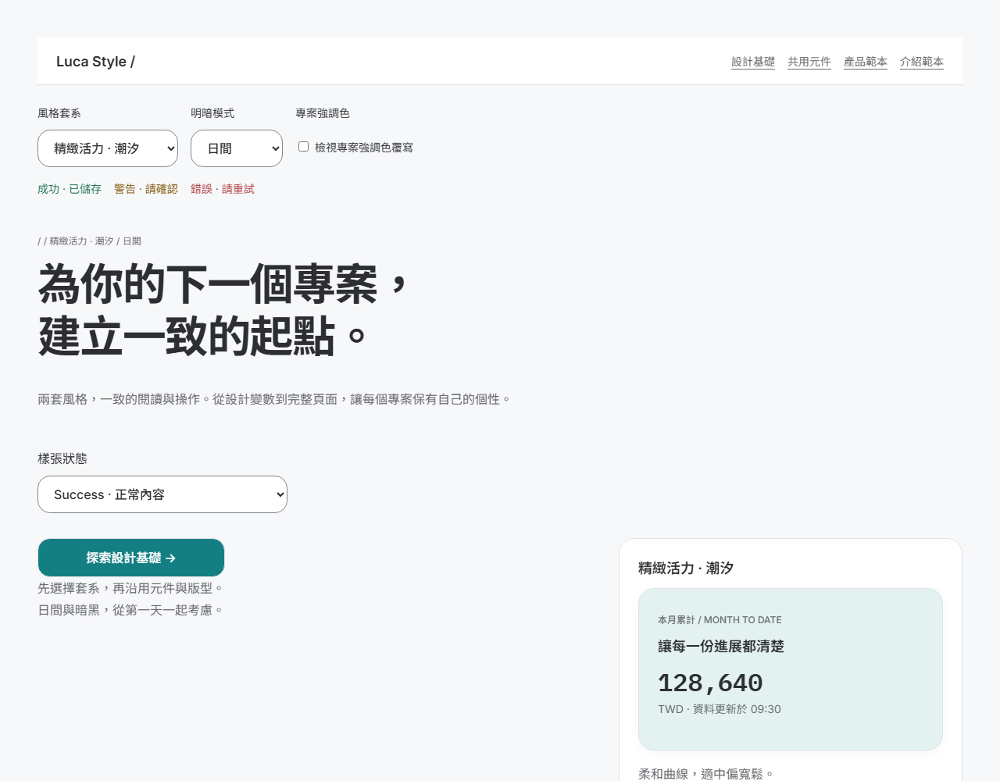
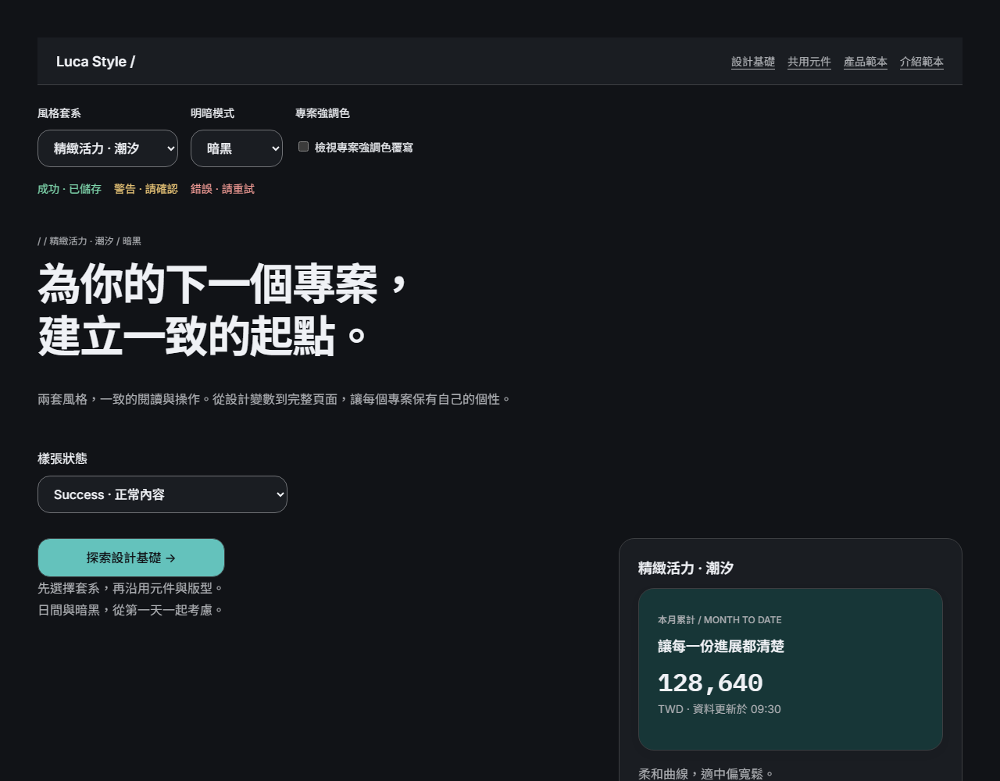
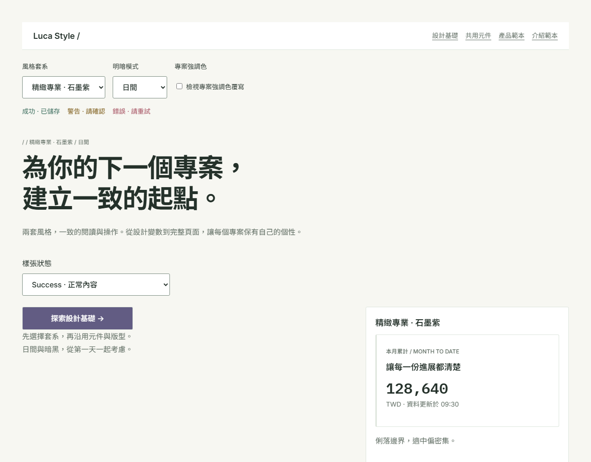
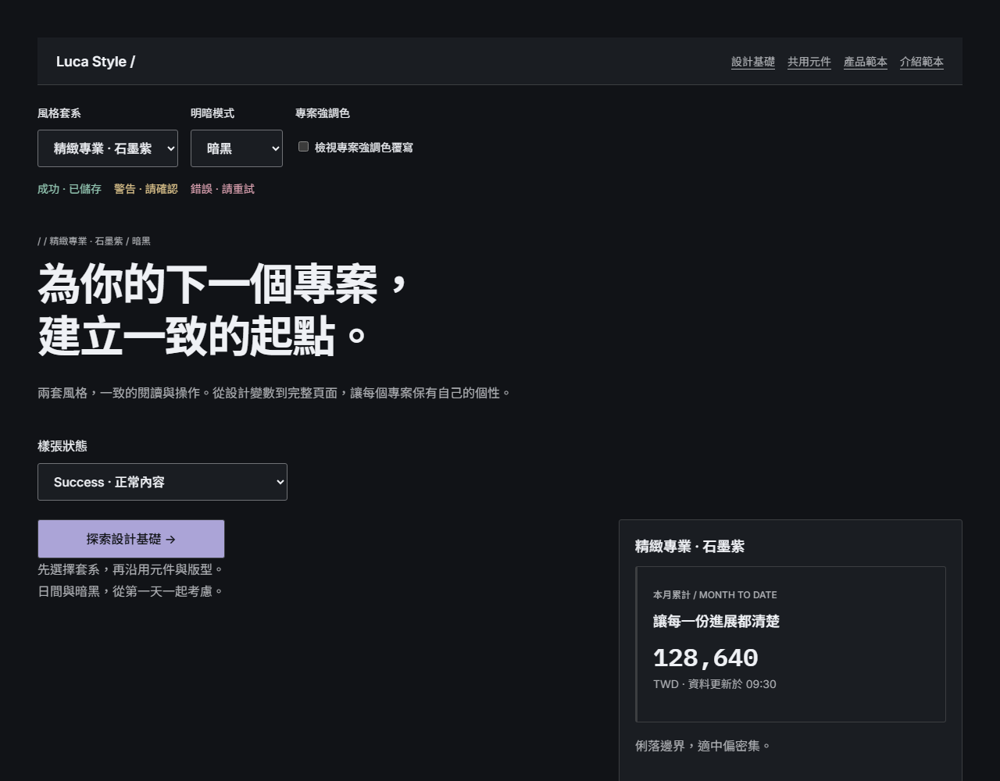

# Luca Style

A reusable React design system with two style suites (vibrant and professional), light/dark modes, shared components, design tokens and page templates. Documentation is in Traditional Chinese. Licensed under MIT.

跨專案設計系統：雙套系、日夜模式、共用元件、設計基礎與產品／介紹頁範本。[線上樣張](https://luca0x5755.github.io/luca-style/)可直接瀏覽，不需先安裝。

| 精緻活力 · 日間 | 精緻活力 · 暗黑 |
| --- | --- |
|  |  |
| **精緻專業 · 日間** | **精緻專業 · 暗黑** |
|  |  |

## 快速開始

需要 Node.js 22.12 以上與 npm 11。

```sh
git clone https://github.com/Luca0x5755/luca-style.git
cd luca-style
npm ci
npm run dev
```

開啟終端顯示的本機網址即是本機預覽；`/` 的主要行動可進入 `/foundations`。

在自己的 React 專案中使用，節錄自 [examples/consumer](examples/consumer/src/main.tsx)：

```tsx
import {ThemeProvider, useTheme, Button, Select, Checkbox, StatusMessage, Navigation, type StyleSuite} from '@luca-style/react';
import '@luca-style/tokens/css';
import '@luca-style/react/fonts.css';
import '@luca-style/react/css';
// …
  return <ThemeProvider suite={suite} accent={custom ? {light:'#275A83',secondary:'#6995B8',soft:{light:'#E7F0F7'}} : undefined}>
// …
  </ThemeProvider>;
```

封裝、安裝、公開 API、字體授權與設計變數同步見[使用端接入文件](docs/consumer-guide.md)。

## 公開套件與文件導覽

- `@luca-style/tokens/css`：產生的 CSS variables。
- `@luca-style/tokens/data`：相同來源的 JSON 資料，以 vibrant/professional、light/dark 兩層索引。
- `@luca-style/react`：Button、表單與回饋、Navigation、MetricCard、DataTable、ThemeProvider、useTheme 及相關型別；搭配 `@luca-style/react/css` 使用。字體另引用 `@luca-style/react/fonts.css`。

| 想做的事 | 文件 |
| --- | --- |
| 在其他專案安裝與套用 | [使用端接入](docs/consumer-guide.md) |
| 讓其他專案的代理執行接入 | [跨專案套用提示詞](docs/adoption-prompt.md)，內附精緻活力與精緻專業的輸入範例 |
| 讓代理使用設計系統 | [DESIGN.md](DESIGN.md) 與 [llms.txt](llms.txt)；每個設計變數的值與用途見[設計變數規格](docs/design-tokens.md)（產生物） |
| 了解設計系統的承諾與範圍 | [設計系統能力規格](docs/capabilities/design-system.md) |
| 查視覺、路由與頁面規則 | [前端規格](docs/05_frontend_spec.md)；設計稿為元件庫設計檔 `docs/mockup/luca-style-library.penpot`（兩套風格的母版與設計變數合為一檔） |
| 查架構與部署方式 | [架構設計](docs/03_architecture_design.md) |
| 查驗收證據與限制 | [交付驗證](docs/delivery-verification.md) |
| 查領域術語 | [術語表](GLOSSARY.md) |

## 開發與驗證

變數來源為 `packages/tokens/src/` 下的 DTCG 分層檔（`base`、`mode/<明暗>`、`suite/<套系>/<common|明暗>`、`typography`），每個變數都要有 `$value`、`$type` 與 `$description`。修改後執行 `npm run generate`，由 Style Dictionary 重新產生輸出（含 `docs/design-tokens.md` 設計變數規格，勿手改）；任一「風格套系 × 明暗模式」組合缺值時建置失敗並列出缺的變數。之後再重建或重啟開發指令。產物在各套件 `dist/`，不納入版本管理。

```sh
npm run build
npm run preview
```

本機預覽位於 [http://127.0.0.1:4173](http://127.0.0.1:4173)。工作區依序建置 tokens、React、showcase。

```sh
npx playwright install chromium
npm run build
npm run typecheck
npm run lint
npm test
```

瀏覽器測試使用獨立的 4173、4175、4176 port，不重用既有伺服器；先關閉這些埠的其他服務。來源串接測試會暫時修改強調色、重建並驗證瀏覽器，最後復原來源及輸出；執行測試時請勿同時編輯 token。

- `npm run test:consumer`：獨立 consumer 驗證（先 build，需要網路、Chromium 與獨立 4174 port）。
- `npm run build:pages`：以 `/luca-style/` 為 base 建置 GitHub Pages 靜態輸出到 `apps/showcase/dist-pages`。push 到 `main` 後由 `.github/workflows/pages.yml` 驗證並部署。
- `npm run screenshots`：重新產生 `docs/images/` 的四張截圖（使用 4177 port，不屬於 `npm test`）；`npm run verify:screenshots` 驗證產生結果穩定。

### 截圖基準

樣張每一頁（含找不到頁面）× 兩種風格套系 × 日間／暗黑 × 寬度 1280／834／390，共 72 張，存於 `tests/__screenshots__/`（PR-STYLE-42）；只含 Success 狀態，設計基礎頁的密度與外形切換維持預設，不在基準內。基準只在 Playwright 官方 Linux Docker 映像（版本與 `@playwright/test` 一致）產生與比對，因為 Windows 與 Linux 字型渲染不同；本機 `npm test` 不含截圖比對。需要 Docker 與 4173 port；首次會下載映像，並在容器內安裝依賴（放在命名 volume `luca-style-visual-node-modules`，不動本機 `node_modules`）。`npm run screenshots` 產生的是 README 用圖，不做比對，與此基準無關。

```sh
npm run test:visual    # 在 Docker 內與基準比對，不符即失敗
npm run update:visual  # 在 Docker 內更新基準；之後檢查並提交 tests/__screenshots__/
npm run update:visual -- --all  # 改寫全部基準；改動低於比對門檻（例如換色）時使用
```

CI 的 `visual` job（`.github/workflows/pages.yml`）用同一個映像比對，通過後才部署。升級 `@playwright/test` 時須同步改 pages.yml 的映像標籤並重新產生基準。

## 授權

程式碼與文件以 [MIT License](LICENSE) 釋出。`packages/react/fonts/` 內的字體維持 SIL Open Font License 1.1，再散布時須保留對應的 OFL 檔案。
